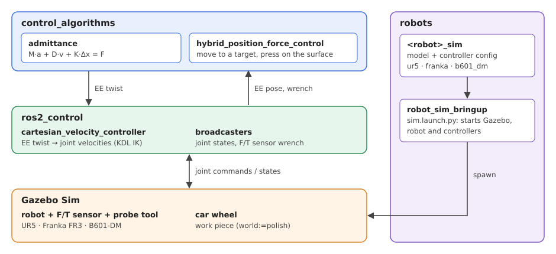

# Compliant Control and Application

Admittance control and hybrid position/force control for robot arms.

Branch `sim-ros2`: ROS 2 Lyrical + Gazebo Sim, simulation. (ROS 1: branch `noetic`.)
Robots: UR5 (`ur5`), Franka Research 3 (`franka`), Seeed reBot Arm B601-DM (`b601_dm`).

## Architecture



- `control_algorithms/`: admittance and hybrid position/force control nodes. They send an end-effector twist.
- `robot_controllers/`: `cartesian_velocity_controller` (ros2_control) turns the twist into joint velocities.
- `robots/`: one `<robot>_sim` package per robot, and `robot_sim_bringup` to start the simulation.

## Installation

### Ubuntu 26.04

Install [ROS 2 Lyrical](https://docs.ros.org/en/lyrical/Installation/Ubuntu-Install-Debs.html), then:

```bash
sudo apt install ros-lyrical-ros2-control ros-lyrical-ros2-controllers \
  ros-lyrical-gz-ros2-control ros-lyrical-ros-gz ros-lyrical-xacro \
  ros-lyrical-ur-description python3-vcstool

mkdir -p ~/cca_ws/src && cd ~/cca_ws/src
git clone -b sim-ros2 https://github.com/MingshanHe/Compliant-Control-and-Application.git
cd Compliant-Control-and-Application && vcs import robots < robots/robots.repos
cd ~/cca_ws && source /opt/ros/lyrical/setup.bash && colcon build --symlink-install
echo 'source ~/cca_ws/install/setup.bash' >> ~/.bashrc
```

### Windows (WSL2)

Install Ubuntu 26.04 in WSL2 and follow the Ubuntu steps. In WSL2 the default
ROS 2 middleware may not connect the nodes, so use Zenoh:

```bash
sudo apt install ros-lyrical-rmw-zenoh-cpp
echo 'export RMW_IMPLEMENTATION=rmw_zenoh_cpp' >> ~/.bashrc
sudo usermod -aG video,render $USER    # GPU for Gazebo; then run `wsl --shutdown` in PowerShell
```

Keep the Zenoh router running in its own terminal while you use ROS:

```bash
ros2 run rmw_zenoh_cpp rmw_zenohd
```

### macOS

Not supported.

## Usage

Start a robot (`robot:=ur5 | franka | b601_dm`):

```bash
ros2 launch robot_sim_bringup sim.launch.py robot:=ur5
```

**Admittance:** a test force of ±1.5 N moves the tool up and down.

```bash
ros2 launch admittance admittance_test.launch.py robot:=ur5
```

**Hybrid position/force control:** press on a car wheel and slide along it.

```bash
ros2 launch robot_sim_bringup sim.launch.py robot:=ur5 world:=polish
ros2 launch hybrid_position_force_control hybrid_position_force_control.launch.py robot:=ur5
ros2 topic pub --once /desired_cartesian_pose_cmd geometry_msgs/msg/Pose "{position: {x: 0.487, y: 0.109, z: 0.17}}"
```

Targets in the robot base frame:

| Robot | Press | Slide (change y) | Home |
|-------|-------|------------------|------|
| `ur5` | `0.487, 0.109, 0.17` | 0.05 … 0.17 | `0.487, 0.109, 0.29` |
| `franka` | `0.307, 0.0, 0.30` | −0.06 … 0.06 | `0.307, 0.0, 0.448` |
| `b601_dm` | `0.341, 0.0, -0.025` | −0.05 … 0.05 | `0.341, 0.0, 0.056` |

Parameters: `control_algorithms/<algorithm>/config/<robot>.yaml`.
Adding a robot: see [`robots/README.md`](robots/README.md).

If the robot does not appear in Gazebo, the ROS 2 nodes cannot reach each
other: use Zenoh as in the WSL2 section.
